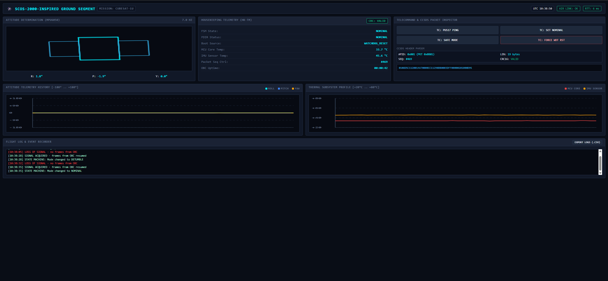

# CubeSat FlatSat – OBC + Ground Segment

A functional FlatSat project demonstrating autonomous, wireless board-to-board communication for a CubeSat educational setup.

The satellite OBC (Raspberry Pi Pico 2 W) and the ground station (ESP32) talk directly over the air using UDP sockets – no middleman PC bridge needed. Telemetry is encapsulated in CCSDS Space Packets, and the ground station serves a Mission Control web dashboard.

---

## System Architecture

### 1. Satellite OBC (Raspberry Pi Pico 2 W)
- Bare-metal C using the Raspberry Pi Pico SDK (pico-sdk ≥ 1.5).
- Reads an **MPU6050** IMU over I²C (roll/pitch from the accelerometer, yaw by integrating the gyro) and the **onboard core temperature** via the ADC.
- Encapsulates housekeeping telemetry into binary frames conforming to the **CCSDS Space Packet** structure, protected by a **CRC-16/CCITT** checksum.
- Connects to the Ground Station Wi-Fi and streams telemetry via UDP; automatically **re-connects** if the link drops.
- Listens for incoming telecommands (PUS-style service/subservice codes).
- Flight state machine: `BOOT → DETUMBLE → NOMINAL ⇄ SAFE`.
- **FDIR** (Fault Detection, Isolation and Recovery) and a hardware **watchdog**.

### 2. Ground Station (FireBeetle 2 ESP32)
- Autonomous Wi-Fi Access Point (`CUBESAT-GROUND-STATION`).
- Listens for telemetry on UDP port 5000, verifies CRC-16 and parses the CCSDS header.
- Hosts a **Mission Control web dashboard** at `http://192.168.4.1`:
  - live 3D attitude wireframe (real MPU6050 data),
  - housekeeping telemetry, FDIR status and boot cause,
  - attitude and thermal history charts,
  - CCSDS header parser and raw hex inspector,
  - **loss-of-signal detection**, link status and ping RTT,
  - event log with CSV export.
- Sends uplink telecommands back to the satellite over UDP port 5001.

---

## Telemetry Packet

Total size: **25 bytes**, sent as an ASCII line `$CCSDS:<50 hex chars>\n`.

| Offset | Size | Field | Notes |
|-------:|-----:|-------|-------|
| 0  | 2 | `packet_id` | `0x0801` → version 0, telemetry, sec. header flag, APID `0x001` |
| 2  | 2 | `packet_seq_ctrl` | `0xC000` (unsegmented) \| 14-bit sequence counter |
| 4  | 2 | `packet_data_len` | data length − 1 (CCSDS convention) → 18 |
| 6  | 4 | `uptime_ms` | OBC uptime |
| 10 | 2 | `mpu_temp_centi_c` | MPU6050 temperature × 100 |
| 12 | 2 | `mcu_temp_centi_c` | Pico core temperature × 100 |
| 14 | 2 | `roll_centi_deg` | × 100 |
| 16 | 2 | `pitch_centi_deg` | × 100 |
| 18 | 2 | `yaw_centi_deg` | × 100, wrapped to ±180° |
| 20 | 1 | `flight_mode` | 0 BOOT, 1 DETUMBLE, 2 NOMINAL, 3 SAFE |
| 21 | 1 | `boot_cause` | 0 POWER_ON, 1 WATCHDOG_RESET |
| 22 | 1 | `fdir_alarm` | 0 OK, 1 OVERHEAT, 2 TUMBLING, 3 IMU FAULT |
| 23 | 2 | `crc16` | CRC-16/CCITT-FALSE (poly `0x1021`, init `0xFFFF`) over bytes 0–22 |

## Telecommands

| Command | Action |
|---------|--------|
| `$TC:10,00` | PUS 17 ping → OBC replies `$TM:PUS17,ALIVE` (used for RTT) |
| `$TC:20,00` | Set NOMINAL mode and clear the FDIR alarm |
| `$TC:20,01` | Set SAFE mode |
| `$TC:99,01` | Force a hardware watchdog reset (stops feeding the watchdog) |

## FDIR

| Alarm | Condition | Action |
|-------|-----------|--------|
| OVERHEAT | MCU or IMU temperature > 65 °C | → SAFE (latched) |
| TUMBLING | \|gyro Z\| > 250 °/s (gyro range set to ±500 °/s) | → SAFE (latched) |
| IMU FAULT | 10 consecutive failed I²C reads | → SAFE (latched), sensor re-init attempts |

SAFE mode lowers the telemetry rate (2 Hz instead of 20 Hz). The alarm is cleared by `$TC:20,00`.

---

## Repository Structure

- `pico_obc_firmware.c` – Main satellite firmware (C / Pico SDK).
- `lwipopts.h` – Network configuration file for the Pico 2 W lwIP stack.
- `CMakeLists.txt` – Build configuration for the Pico SDK.
- `ground_station/esp32_ground_station.ino` – Ground station firmware and web dashboard (Arduino IDE).
- `ground_station/bridge_legacy.py` – Legacy serial bridge script kept for bench debugging.

---

## How to Run

### 1. Ground Station (ESP32)
1. Open `ground_station/esp32_ground_station.ino` in the Arduino IDE (ESP32 board package installed) and flash it.
2. Once powered, it broadcasts the Wi-Fi network `CUBESAT-GROUND-STATION` (password: `12345678`).

### 2. Satellite OBC (Pico 2 W)
1. Wire the MPU6050: `SDA → GP16`, `SCL → GP17`, `3V3`, `GND`.
2. Build with CMake/Ninja and drop `pico_obc_firmware.uf2` onto the Pico.
3. When powered, it connects to the ESP32 AP and starts transmitting packets.

### 3. Mission Control Dashboard
1. Connect your PC or phone to the `CUBESAT-GROUND-STATION` Wi-Fi.
2. Open `http://192.168.4.1` in a browser.

---

## Known Limitations

- **Yaw drift:** yaw is obtained by integrating the gyro (no magnetometer / sun sensor), so it drifts over time.
- **Byte order:** packet fields are little-endian (native MCU order); the CCSDS standard specifies big-endian.
- **No authentication:** telecommands are unauthenticated and the Wi-Fi password is a default one. A real mission would use CCSDS SDLS / link-layer security.
- **Dashboard polling:** the browser polls the ESP32 at ~8 Hz while the OBC downlinks at ~20 Hz, so not every frame reaches the charts/CSV.
- Wi-Fi/UDP is a bench substitute for a real RF link (UHF/S-band, AX.25/CCSDS framing).

## Future Work

- Sequence-based packet loss statistics and a frame queue on the ground station.
- Big-endian packets and telecommand authentication.
- Magnetometer for yaw, and a basic B-dot detumbling controller.
- Port the OBC software to a flight-software framework (NASA F´ / cFS).
- Unit tests (CRC, packet encode/decode) and CI.

---

## Author

Christos Kostogiannis